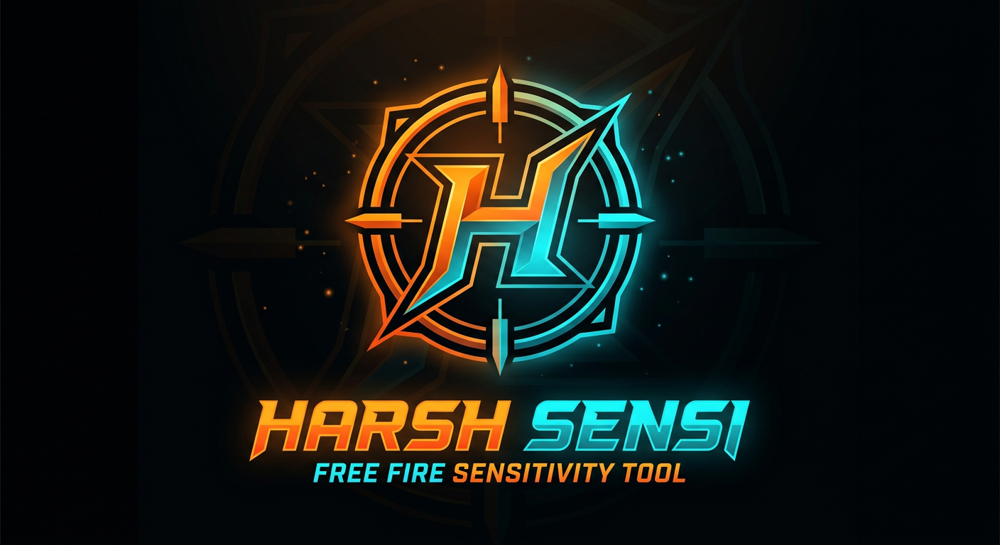

<p align="center">
  
</p>

```
██╗  ██╗ █████╗ ██████╗ ███████╗██╗  ██╗
██║  ██║██╔══██╗██╔══██╗██╔════╝██║  ██║
███████║███████║██████╔╝███████╗███████║
██╔══██║██╔══██║██╔══██╗╚════██║██╔══██║
██║  ██║██║  ██║██║  ██║███████║██║  ██║
╚═╝  ╚═╝╚═╝  ╚═╝╚═╝  ╚═╝╚══════╝╚═╝  ╚═╝

███████╗███████╗███╗   ██╗███████╗██╗
██╔════╝██╔════╝████╗  ██║██╔════╝██║
███████╗█████╗  ██╔██╗ ██║███████╗██║
╚════██║██╔══╝  ██║╚██╗██║╚════██║██║
███████║███████╗██║ ╚████║███████║██║
╚══════╝╚══════╝╚═╝  ╚═══╝╚══════╝╚═╝
```

<p align="center">

# ⚡ HARSH SENSI ⚡

### Free Fire Sensitivity Engine — Developer: **HARSH**


</p>

---

## 🙏 WELCOME HARSH SENSI

**HARSH SENSI** ek advanced Free Fire Sensitivity Generator hai jo aapke device ki **real performance** ko analyze karke optimized sensitivity banata hai.

YouTube videos se random sensitivity copy karne ki jagah, HARSH SENSI aapke phone ki actual specs aur live performance benchmark karke **personalized sensitivity** generate karta hai — taaki aapko mile smoother gameplay, better drag control, solid recoil management aur consistent headshot experience.

Budget phone ho ya flagship — HARSH SENSI automatically aapke hardware ke hisab se sensitivity adapt kar deta hai.

### ✨ Key Highlights

* 📱 Real Device Detection
* ⚡ Live CPU & RAM Benchmarking
* 🎯 Headshot Optimized Sensitivity
* 📊 Performance Based Calculations
* 📄 TXT & JSON Output Files
* 🚀 Quick Scan & Full Scan Modes
* 🛠 Performance Boost Script Generation
* 📲 Android & Termux Compatible
* 🌈 Colourful ASCII Logo + WELCOME Banner
* 🙏 Exit par **JAI SHREE RAM**

Simply run the tool, wait for the scan to complete, aur generated sensitivity values Free Fire ke andar apply karo. Headshot lagao, Booyah karo! 🎯

---

## 📥 Installation

<p align="center">
  <a href="https://f-droid.org/repo/com.termux_118.apk">
    
  </a>
</p>

### Setup Termux

Run the following commands:

```bash
pkg update && pkg upgrade -y
pkg install python
pkg install git
git clone https://github.com/Dev-Harshupadhyay/HARSHSENSI.git
cd HARSHSENSI
python z_run.py
```

> **Auto Setup:** Sirf ek command me sab setup + run ho jayega:
> ```bash
> bash i0x.sh
> ```

---

## 📂 File Structure

```text
HARSHSENSI/
│
├── README.md
│
├── logo.png
│   └── HARSH SENSI Logo
│
├── logo.txt
│   └── ASCII Logo (terminal ke liye)
│
├── z_run.py
│   └── Main launcher file
│
├── i0x.sh
│   └── Auto install & run script
│
├── x9k/
│   │
│   ├── m7q.py
│   │   └── Device Detection Engine
│   │
│   ├── p4r.py
│   │   └── Benchmark & Performance Engine
│   │
│   ├── s2k.py
│   │   └── Sensitivity Generator
│   │
│   ├── t8n.py
│   │   └── Boost Script Generator
│   │
│   ├── v1u.py
│   │   └── Terminal UI, ASCII Art & Colors
│   │
│   └── d8f.json
│       └── Device Tier Database
│
└── o0x/
    │
    ├── x_device.txt
    │   └── Generated Sensitivity
    │
    ├── x_device.json
    │   └── Detailed Scan Report
    │
    ├── b0x.sh
    │   └── Performance Boost Script
    │
    └── g0x.sh
        └── Game Optimization Script
```

---

## 🚀 Available Commands

| Command                            | Description                             |
| ---------------------------------- | --------------------------------------- |
| `python3 z_run.py`                 | Full Device Scan & Generate Sensitivity |
| `python3 z_run.py --q`             | Quick Scan Mode                         |
| `python3 z_run.py --i`             | Show Device Information                 |
| `python3 z_run.py --qp`            | Generate Performance Scripts            |
| `python3 z_run.py --rn 5`          | Run Benchmark 5 Times                   |
| `python3 z_run.py --rn 10`         | Run Benchmark 10 Times                  |
| `python3 z_run.py --m DEVICE_NAME` | Manual Device Name                      |
| `python3 z_run.py --help`          | Show Help                               |
| `bash i0x.sh`                      | Auto Setup & Run HARSH SENSI            |

---

## 📊 Sample Output

```text
======================================================
  HARSH SENSI - SENSITIVITY ENGINE
  HARSH SENSI | Developer HARSH
  SCALE 1-200
======================================================
DEVICE : Redmi Note 13
CHIP   : ...
PANEL  : 1080x2400 @90Hz 440dpi
RAM    : 8.0GB | BATT 85% | LOAD 0.42
TOUCH  : 240Hz | LAT 4.17ms
POWER  : 72.5/100 | GFXIDX ... | BOOST 8.0
TIER   : upper_mid | HS_MODE ON

--- INGAME ---
General           : 152
Red Dot           : 138
2x                : 126
4x                : 110
Sniper            : 101
Free Look         : 143

--- HARSH SENSI | Developer HARSH ---
======================================================
```

---

## ❤️ Special Thanks

<p align="center">

### Project Developer & Maintainer

# 🌟 HARSH

**Developer: HARSH** — HARSH SENSI ka creator, developer aur maintainer.
Har player ke liye, har device ke liye — ek personal sensi engine. 💙

</p>

---

<p align="center">

<b>Made with ❤️ by HARSH for the Free Fire Community</b>

# 🙏 JAI SHREE RAM 🙏

</p>
